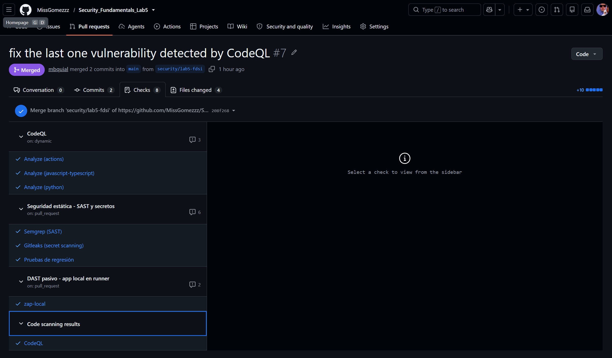
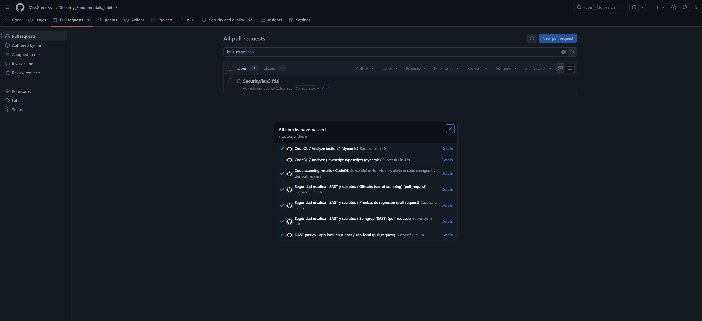
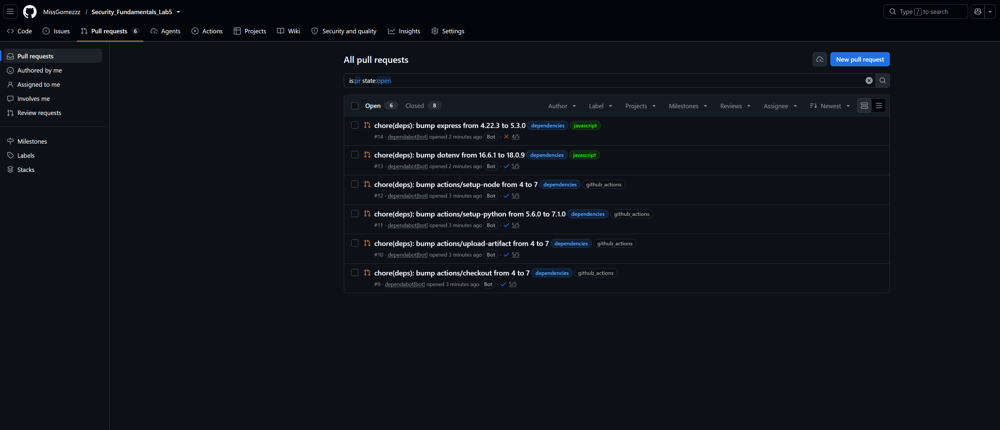
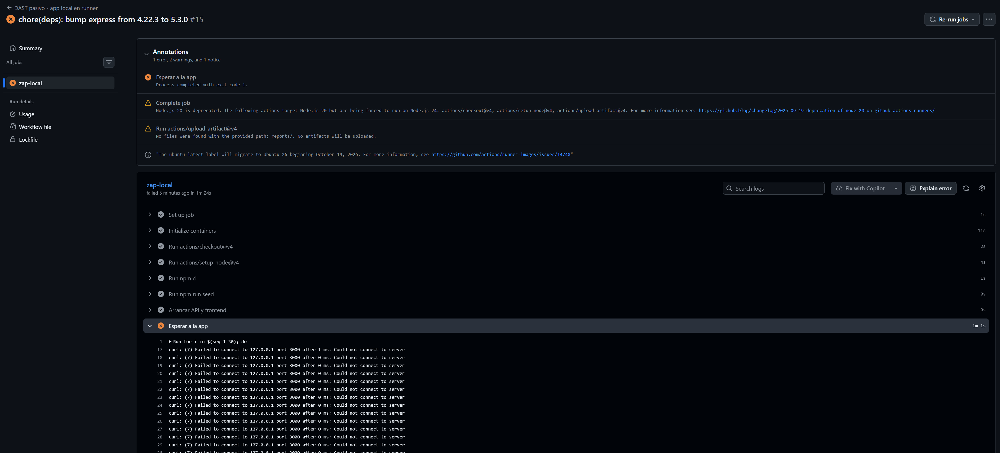

# Pull Requests del laboratorio 5

Todos los PR parten de la rama `security/lab5-fdsi` hacia `main` y se fusionaron con merge commit.
Base URL: <https://github.com/MissGomezzz/Security_Fundamentals_Lab5/pull/N>

| PR | Tipo | Fusionado | Merge commit | Contenido |
|---|---|---|---|---|
| [#4](https://github.com/MissGomezzz/Security_Fundamentals_Lab5/pull/4) | **Integración** | 28 oct 2026 17:53 | `7574354` | Workflow Semgrep + Gitleaks y plantillas de documentación de seguridad |
| [#5](https://github.com/MissGomezzz/Security_Fundamentals_Lab5/pull/5) | Integración (ajuste) | 2 nov 2026 18:48 | `dbe664f` | Acciones fijadas por SHA |
| [#6](https://github.com/MissGomezzz/Security_Fundamentals_Lab5/pull/6) | **Remediación** | 8 nov 2026 11:38 | `b6b655b` | Dependabot, CodeQL, API key, rate limit de la API, dependencias |
| [#7](https://github.com/MissGomezzz/Security_Fundamentals_Lab5/pull/7) | Remediación (complemento) | 8 nov 2026 11:54 | `9968a09` | "fix the last one vulnerability detected by CodeQL": rate limit del frontend |

> Las descripciones y conversaciones de los PR no se pueden leer desde el repositorio local. Lo que sigue se reconstruyó del historial de git (commits, fechas, merges) y de las capturas. Los títulos del #6 ("Security/lab5 fdsi") y del #7 ("fix the last one vulnerability detected by CodeQL") salen de capturas; los de #4 y #5 no se han visto.

## PR de integración — #4 (y ajuste #5)

**Objetivo:** incorporar al repositorio los controles de seguridad automatizados de la plantilla del laboratorio (`docs/README_INTEGRACION.md`) y la documentación base.

**Commits**
- `9fe3d60` — `chore(security): add Semgrep + Gitleaks workflow and security docs` (28 oct).
- `d043d24` — `fixing workflow with SHA!` (28 oct): fija las acciones por SHA tras el primer escaneo de Semgrep (PR #5).

**Cambios principales:** `.github/workflows/seguridad-estatica.yml` (jobs `sast` y `secretos`), `docs/CHECKLIST_PR.md`, `docs/README_INTEGRACION.md`, `docs/REPORTE_HALLAZGOS.md`, `docs/SECURITY.md`.

**Resultado:** Semgrep y Gitleaks quedan ejecutándose en cada push a `main` y en cada PR. Primer escaneo: 9 hallazgos WARNING; tras el ajuste de SHA (PR #5): 4. Los JSON de ese escaneo se versionaron después, en el PR #6.

**Evidencia:** el equipo decidió **no incluir capturas de las páginas de los PR #4 y #5**. Su contenido queda respaldado por el historial de git (commits `9fe3d60` y `d043d24`, merges `7574354` y `dbe664f`) y por los resultados de Semgrep en `evidence/SAST/`. Si el evaluador exige la captura de un PR de integración, es la única parte de este entregable sin imagen.

## PR de remediación — #6 (y complemento #7)

**Objetivo:** corregir los hallazgos F-01, F-02, F-03 y F-06 detectados por CodeQL, Dependabot, la revisión manual y las pruebas, y añadir las pruebas de regresión y los controles automáticos que los vigilan.

**Commits del PR #6**

| Commit | Cambio | Hallazgo |
|---|---|---|
| `09d876b` | Evidencia SAST: `semgrep_before.json`, `semgrep_after.json`, `resumen.py` | Semgrep (F-04, F-05) |
| `90168bd` | Añade configuración de Dependabot (archivo `dependatbot.yml`) | F-08 (errata) |
| `567f192` | Refactor de estructura para legibilidad | — |
| `70dd82a` | API key en rutas de escritura y auditoría, `x-powered-by` desactivado, 4 pruebas de seguridad, job `pruebas` y `API_KEY` en el DAST | F-03, F-06 |
| `40b58fa` | Refactor de nombre de archivo y middleware (commit sobre el que CodeQL reportó 3 alertas) | F-01 detectado |
| `e540898`, `7b038a3` | Evidencia de CodeQL | — |
| `541cc20` | Actualiza `package-lock.json` | F-02 |
| `38cf99b` | Rate limiting de la API, prueba del 429 y actualización de `risk-register.md` | F-01 |

**PR #7 — "fix the last one vulnerability detected by CodeQL":** fusionado por `mbquial`, 2 commits, 4 archivos modificados (+10 líneas). Commits: `7fe9051` (rate limiting en `web-frontend/server.js`, cierra la alerta CodeQL #1 de `server.js:29`) y el merge `208f268` de la rama. La pestaña *Checks* muestra 8 comprobaciones en verde: CodeQL (`actions`, `javascript-typescript`, `python`), Semgrep, Gitleaks, pruebas de regresión, ZAP (`zap-local`) y *Code scanning results*.

**Verificación antes de fusionar (PR #6):** 7/7 checks en verde.

**Resultado tras la fusión**
- CodeQL en `main`: 0 abiertas, 7 cerradas como fixed ([captura](../evidence/lab5/hallazgos_fixed_CodeQL.png)).
- Dependabot: 0 abiertas, 5 cerradas como Fixed ([captura](../evidence/lab5/alertas_fixed_dependatbot.png)).
- Pruebas de regresión: 5/5 en verde el 8 nov ([captura](../evidence/lab5/security_test_5_pruebas.png)); `npm audit`: 0 vulnerabilidades ([captura](../evidence/lab5/npm_audit_after.png)).

**Descripción sugerida para el PR #6** (por si hay que completarla en GitHub):

> Remediación de hallazgos de seguridad del Lab 5. Añade autenticación por API key a los endpoints de escritura y auditoría (F-03), desactiva `X-Powered-By` (F-06), aplica rate limiting con `express-rate-limit` (F-01, alertas CodeQL de missing rate limiting), actualiza `proxy-addr`, `body-parser`, `qs` y `express` en el lockfile (F-02, 5 alertas de Dependabot) y agrega pruebas de regresión. Evidencia en `docs/SECURITY.md`. Riesgos residuales: F-05, F-07, F-08.

**Checklist de seguridad del PR:** [`CHECKLIST_PR.md`](CHECKLIST_PR.md).

⚠️ **PENDIENTE (opcional) — captura del PR #6 ya fusionado.** El PR #6 se capturó solo **antes** del merge (abierto, 7/7 checks). Si se quiere, agregar su estado "Merged" con commits y archivos cambiados como `evidence/lab5/pr6_remediacion_merged.png` y enlazarla aquí. El PR #7 ya tiene captura post-merge.

## Pull Requests automáticos de Dependabot (#9 a #14)

Tras renombrar `dependatbot.yml` a `dependabot.yml` (F-08, commit `555a33e`), Dependabot empezó a abrir PR de actualización de versión. Son PR de **mantenimiento**, no de remediación de los hallazgos del laboratorio, y a la fecha de la captura siguen **abiertos y sin fusionar**.

| PR | Título | Etiquetas | Checks |
|---|---|---|---|
| [#9](https://github.com/MissGomezzz/Security_Fundamentals_Lab5/pull/9) | `chore(deps): bump actions/checkout from 4 to 7` | dependencies, github_actions | 5/5 |
| [#10](https://github.com/MissGomezzz/Security_Fundamentals_Lab5/pull/10) | `chore(deps): bump actions/upload-artifact from 4 to 7` | dependencies, github_actions | 5/5 |
| [#11](https://github.com/MissGomezzz/Security_Fundamentals_Lab5/pull/11) | `chore(deps): bump actions/setup-python from 5.6.0 to 7.1.0` | dependencies, github_actions | 5/5 |
| [#12](https://github.com/MissGomezzz/Security_Fundamentals_Lab5/pull/12) | `chore(deps): bump actions/setup-node from 4 to 7` | dependencies, github_actions | 5/5 |
| [#13](https://github.com/MissGomezzz/Security_Fundamentals_Lab5/pull/13) | `chore(deps): bump dotenv from 16.6.1 to 18.0.9` | dependencies, javascript | 5/5 |
| [#14](https://github.com/MissGomezzz/Security_Fundamentals_Lab5/pull/14) | `chore(deps): bump express from 4.22.3 to 5.3.0` | dependencies, javascript | **4/5** (falla DAST/ZAP) |

**PR #14 (`express` 4.22.3 → 5.3.0): por qué falla.** Falla el check *DAST pasivo - app local en runner / zap-local* (la captura muestra la ejecución #15 del workflow). El paso *Esperar a la app* agota 30 intentos de `curl` a `127.0.0.1:3000` (1 min 1 s) con `Could not connect to server`: el frontend no arranca. Reproducido en la aplicación real: con Express 5.3.0 sin tocar el código, `node app/web-frontend/server.js` termina con `Missing parameter name at index 1: *`, porque el comodín `app.get('*', ...)` ya no es válido en Express 5 (`path-to-regexp` v8). El log del runner no está en la captura. Efectos colaterales vistos en las anotaciones: advertencia de Node.js 20 obsoleto para `checkout@v4`, `setup-node@v4` y `upload-artifact@v4`, y *No files were found ... reports/* porque ZAP nunca corrió.

### Migración a Express 5: hecha en la copia de trabajo, pendiente de PR

**Respuesta corta: sí, la aplicación sigue funcionando con Express 5**, con un único cambio de código.

| Archivo | Cambio |
|---|---|
| `app/web-frontend/server.js` | `app.get('*', ...)` → `app.get('/{*splat}', ...)` (con un comentario del motivo) |
| `app/alerts-api/package.json` | `"express": "^4.21.2"` → `"^5.3.0"` |
| `app/web-frontend/package.json` | `"express": "^4.21.2"` → `"^5.3.0"` |
| `package-lock.json` | Express 5.3.0 y sus dependencias (`router`, `path-to-regexp` v8, etc.), 13 paquetes añadidos y 6 eliminados |

`alerts-api` no necesitó cambios de código: no usa comodines, y las rutas, el middleware (`cors`, `morgan`, `express-rate-limit` 8, `express.json`) y el manejador de errores se comportan igual. `req.body` ausente (petición sin cuerpo) ya estaba protegido con `req.body && ...`.

**Cómo se validó** (detalle en [`evidence/express5/README.md`](../evidence/express5/README.md)): una prueba de humo de 31 comprobaciones ejecutada con el **mismo script** sobre Express 4.22.3 (línea base) y sobre Express 5.3.0, con los dos servicios corriendo y una PostgreSQL 16 desechable en Docker (eliminada al terminar). Resultado: 28 comprobaciones idénticas y 3 líneas distintas, ambas explicadas (filas acumuladas de `audit_log`; `Content-Type` de `/app.js` y `/styles.css` pasa a `text/javascript; charset=utf-8` y `text/css; charset=utf-8`). Además: `npm test` 5/5, `npm audit` 0 vulnerabilidades, `node --check` sin errores.

**Para cerrarlo:** hacer commit del cambio y abrir un PR (por ejemplo, `chore: migrate to Express 5`) o subirlo a la rama del PR #14; verificar que el check *zap-local* pasa en CI (el único paso no reproducido localmente es el de GitHub Actions con Node 20 y Ubuntu). Al fusionar, el PR #14 de Dependabot queda redundante. **Aún no se hizo commit ni PR.**

**Decisión pendiente sobre los demás.** Los PR #9 a #12 (acciones de GitHub) y #13 (`dotenv` 16 → 18) pasan 5/5 y son saltos de versión mayor: leer las notas de cambio antes de fusionar. Los de `github_actions` son la vía natural para mantener las acciones fijadas por SHA (F-04), y la advertencia de Node 20 en el job refuerza actualizarlas. Los PR #9 a #14 son además la evidencia de que F-08 quedó resuelto.

## Pendientes derivados que deberían ir en un PR nuevo
1. Hacer commit y PR de la migración a Express 5 (ver sección anterior) y hacer triage de los otros 5 PR de Dependabot (#9 a #13).
2. Fijar por SHA las acciones restantes de `seguridad-estatica.yml` (job `pruebas`) y `dast-local.yml` (F-04).
3. Configurar `trust proxy` y validar el rate limiting detrás de Nginx (F-07).
4. Corregir las cabeceras del frontend (F-09) y `X-Powered-By` en el frontend (F-06), y volver a ejecutar ZAP para tener el informe "después".
