# Informe técnico de hallazgos

**Proyecto:** `muvautomation-secure-challenge`.

**Integrantes:** María Belén Quintero, Ángela Sofía Gómez Valencia.

**Repositorio / commit:** <https://github.com/MissGomezzz/Security_Fundamentals_Lab5> — línea base `09d876b4ca5e5c8db6af2053852e88e2487763f4` (rama `security/lab5-fdsi`); remediaciones fusionadas en `main` @ `9968a09` (merge PR #7); estado final evaluado `main` @ `4f31229` (incluye la migración a Express 5, `7e76984`, hecha sin PR; ver F-02).

**Entorno autorizado:** API y frontend locales (`127.0.0.1`), PostgreSQL local con datos ficticios y runners efímeros de GitHub Actions. Sin producción ni terceros.

**Fecha:** pruebas del 6 al 8 de noviembre de 2026 (autorización: viernes 6 de noviembre de 2026).

## Resumen ejecutivo
Se integró un pipeline de seguridad (Semgrep, CodeQL, Gitleaks, Dependabot, ZAP baseline y pruebas de regresión) y se recorrió el ciclo completo: detectar, validar, corregir y reescanear. Se registraron **9 hallazgos**: **6 corregidos y verificados** (F-01, F-02, F-03, F-04 en los workflows de Semgrep/Gitleaks, F-06 en la API y F-08) y 3 abiertos (F-05 aceptado, F-07 sin validar y F-09 por cabeceras del frontend). F-04 y F-06 conservaban una parte abierta. El 8 nov se corrigieron en el código esas partes y F-09 (`helmet`, SHA en las acciones restantes; ver `SECURITY.md` 2.8), **verificadas (11 pruebas, un ZAP posterior sin Medium ni Low y un Semgrep final sin la regla de acciones mutables) y ya en `main` (`f775052`), sin PR y sin captura de sus runs de CI**.

Los tres riesgos principales fueron:
1. **Dependencias vulnerables (F-02, crítico).** `proxy-addr` (IP spoofing, Critical), `body-parser` (DoS, High) y `qs` (3 DoS/bypass, Moderate) llegaban de forma transitiva con Express. Importa porque `proxy-addr` decide qué IP se considera la del cliente, base de cualquier control por IP. **Corregido** actualizando el lockfile; Dependabot pasó de 5 alertas abiertas a 0.
2. **Escritura y auditoría sin autenticación (F-03, alto).** Cualquiera con acceso a la API podía crear alertas, cambiar su estado o leer el historial de auditoría. **Corregido** con clave de API comparada en tiempo constante; validado con un pentest controlado (401, 401, 200).
3. **Ausencia de límite de peticiones (F-01, alto).** CodeQL marcó 7 rutas que consultan la base de datos sin rate limiting (riesgo de agotamiento de recursos). **Corregido** en API y frontend; CodeQL pasó a 0 alertas abiertas.

## Metodología
Identificación del alcance → SAST (Semgrep, CodeQL) → detección de secretos (Gitleaks) → SCA (Dependabot, `npm audit`) → DAST pasivo (ZAP baseline, local al runner) → validación manual no destructiva (3 solicitudes `curl` al API local) → corrección en la rama `security/lab5-fdsi` mediante Pull Request → reescaneo y comparación antes/después.

### Resumen de hallazgos

| ID | Título | Fuente | Severidad | Estado |
|---|---|---|---|---|
| F-01 | Rutas con acceso a base de datos sin rate limiting | CodeQL | Alta | Corregido |
| F-02 | Dependencias transitivas vulnerables | Dependabot / `npm audit` | Crítica | Corregido |
| F-03 | Endpoints de escritura y auditoría sin autenticación | Revisión + pentest | Alta | Corregido |
| F-04 | Acciones de GitHub con tag mutable | Semgrep | Media | Corregido y verificado con el Semgrep final (en `main` desde `f775052`, sin PR) |
| F-05 | `$host` no validado en `proxy_set_header Host` | Semgrep | Baja | Abierto (aceptado) |
| F-06 | Cabecera `X-Powered-By` | Revisión, prueba y ZAP | Baja | Corregido en la API y en el frontend (verificado con el ZAP posterior; en `main` desde `f775052`, sin PR) |
| F-08 | Configuración de Dependabot con nombre de archivo erróneo | Revisión de proceso | Baja | Corregido y verificado |
| F-09 | Frontend sin CSP, anti-clickjacking, `nosniff` ni cabeceras Cross-Origin | OWASP ZAP | Media | Corregido y verificado con el ZAP posterior (en `main` desde `f775052`, sin PR) |

---

## Hallazgo F-01 — Falta de rate limiting
- **Título:** Rutas de la API y del frontend con acceso a base de datos sin límite de peticiones.
- **Categoría OWASP/CWE:** A04:2021 Insecure Design / CWE-770 (asignación de recursos sin límites). Regla CodeQL `js/missing-rate-limiting`.
- **Severidad y justificación:** Alta (CodeQL la clasifica *High*). Un cliente puede lanzar peticiones repetidas que consumen conexiones del pool de PostgreSQL (`max: 10`) y degradan el servicio. Las rutas de lectura son públicas por diseño, lo que aumenta la exposición.
- **Evidencia minimizada:** 3 alertas en el PR #6 (`index.js` líneas 139, 157, 180) y 7 en `main` (6 en `alerts-api/src/index.js` y 1 en `web-frontend/server.js:29`). Mensaje: *"This route handler performs a database access, but is not rate-limited"*.
  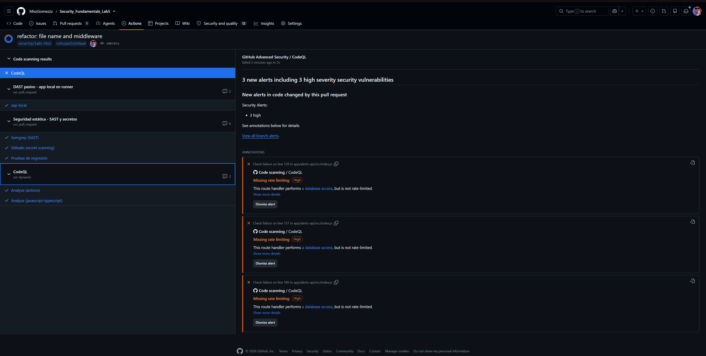
- **Impacto:** Disponibilidad (principal). Confidencialidad/integridad indirectas al facilitar fuerza bruta sobre la API key.
- **Pasos de validación segura en entorno propio:** `npm test -w alerts-api` ejecuta 61 peticiones concurrentes a `/api/audit` y espera que la última devuelva `429`. Ejecutar solo contra la instancia local.
- **Corrección:** `38cf99b` (rate limit de la API: 60 solicitudes por minuto, cabeceras `RateLimit` estándar draft-8, mensaje `rate_limit_exceeded`; nueva dependencia `express-rate-limit`) y `7fe9051` (el mismo límite en `web-frontend/server.js`). PR #6 y PR #7.
- **Resultado del reescaneo:** CodeQL en `main`: **0 abiertas, 7 cerradas como "fixed"**.
  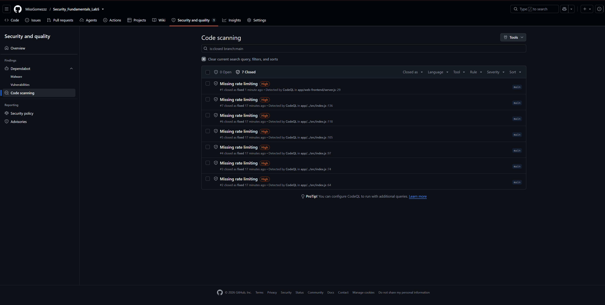
- **Reescaneo de las pruebas:** `npm test` con las **5** pruebas en verde el 8 nov 2026 (61 solicitudes a `/api/audit`: las primeras responden 401 y las últimas 429).
  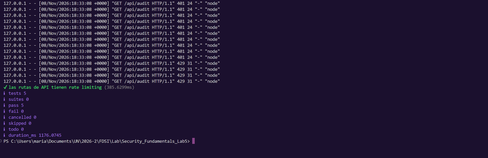

## Hallazgo F-02 — Dependencias transitivas vulnerables
- **Título:** `proxy-addr`, `body-parser` y `qs` con vulnerabilidades conocidas (5 advisories).
- **Categoría OWASP/CWE:** A06:2021 Vulnerable and Outdated Components.
- **Severidad y justificación:** Crítica por el advisory de `proxy-addr` (Critical). Los demás: `body-parser` High (DoS), `qs` Moderate (×3, DoS y bypass del límite de arrays). Son dependencias de Express que procesan entrada no confiable en cada petición.
- **Evidencia minimizada:**

  | # | Paquete | Severidad | Corregida en |
  |---|---|---|---|
  | 3 | proxy-addr | Critical | 2.0.8 (desde 2.0.7) |
  | 4 | body-parser | High | 1.20.9 (desde 1.20.8) |
  | 1, 2, 5 | qs | Moderate | 6.16.2 (desde 6.15.3) |

  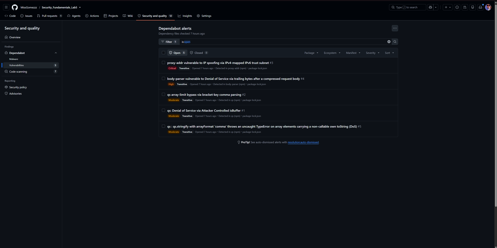
  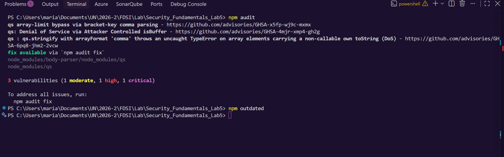
- **Impacto:** Disponibilidad (DoS por parseo), integridad de los controles basados en IP (spoofing).
- **Pasos de validación segura:** `npm audit` desde la raíz del repositorio; no requiere explotar nada. `npm audit fix` fue la vía sugerida por la herramienta.
- **Corrección:** `541cc20` — actualiza `package-lock.json` (también `express` 4.22.2 → 4.22.3). PR #6.
- **Resultado del reescaneo:** Dependabot: **0 abiertas, 5 cerradas "Fixed"**.
  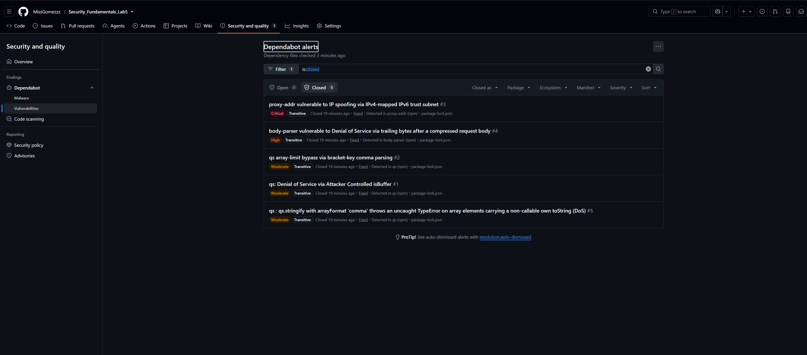
  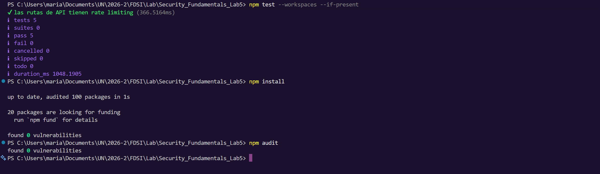
- **Verificación local:** `npm audit` → *found 0 vulnerabilities*. La captura inicial de `npm outdated` quedó sin salida, por lo que no se usa como evidencia de "dependencias al día".

## Hallazgo F-03 — Endpoints sin autenticación
- **Título:** `POST /api/alerts`, `PATCH /api/alerts/:id/status`, `POST /api/alerts/aggregates` y `GET /api/audit` accesibles sin credenciales.
- **Categoría OWASP/CWE:** A01:2021 Broken Access Control / CWE-306 (falta de autenticación en función crítica).
- **Severidad y justificación:** Alta. Permitía alterar el estado de incidentes (integridad), e inyectar alertas falsas o leer el historial de auditoría (confidencialidad), y la falta de identidad afecta la trazabilidad. Era una limitación declarada del Lab 3 con aplazamiento al Lab 4.
- **Evidencia minimizada:** diff de `70dd82a` (se añade `requireApiKey` a las cuatro rutas). Resultado del pentest: P-02 y P-03 → 401; P-04 con clave válida → 200. La clave real aparece tachada.
  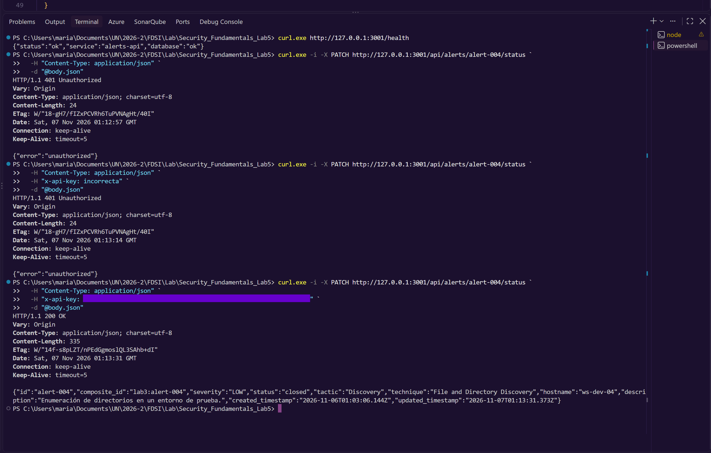
- **Impacto:** Integridad (alto), confidencialidad (medio, auditoría), disponibilidad (bajo, mediante carga de alertas).
- **Pasos de validación segura en entorno propio:** ver [registro del pentest](#registro-del-pentest-controlado).
- **Corrección:** `70dd82a` — middleware `requireApiKey` que lee `API_KEY` del entorno, devuelve `503 api_key_not_configured` si no está definida (falla cerrada), y compara con `crypto.timingSafeEqual` tras verificar la longitud; respuesta genérica `401 {"error":"unauthorized"}`. PR #6.
- **Resultado del reescaneo:** pruebas de regresión 4/4 en verde.
  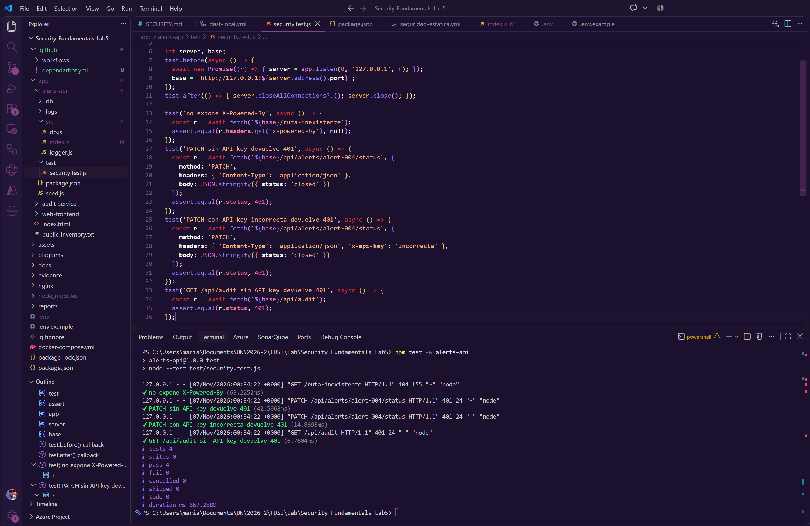

## Hallazgo F-04 — Acciones de GitHub con tag mutable
- **Título:** Acciones de terceros referenciadas por tag o rama (`@v4`).
- **Categoría OWASP/CWE:** A08:2021 Software and Data Integrity Failures / CWE-829. Regla Semgrep `github-actions-mutable-action-tag`.
- **Severidad y justificación:** Media (Semgrep: WARNING). Un tag puede reasignarse y ejecutar código distinto dentro del pipeline que maneja `GITHUB_TOKEN` y `secrets.API_KEY`.
- **Evidencia minimizada:** 5 hallazgos en `seguridad-estatica.yml` (líneas 14, 15, 24, 33, 37) en [`semgrep_before.json`](../evidence/SAST/semgrep_before.json).
- **Impacto:** Integridad de la cadena de suministro del CI.
- **Pasos de validación segura:** `python evidence/SAST/resumen.py` (ajustando el archivo a leer) o `semgrep scan --config p/owasp-top-ten`. Solo lectura estática.
- **Corrección:** `d043d24` fija a SHA los pasos de Semgrep y Gitleaks (checkout, setup-python, upload-artifact, gitleaks-action), con el tag como comentario. PR #5.
- **Resultado del reescaneo (tras el PR #5):** 0 hallazgos de esta regla en [`semgrep_after.json`](../evidence/SAST/semgrep_after.json) (9 → 4 en total).
- **Reescaneo intermedio (8 nov 2026, [`semgrep_intermedio_8nov.json`](../evidence/SAST/semgrep_intermedio_8nov.json)):** la regla vuelve a aparecer **5 veces**, tal como se anticipó: `seguridad-estatica.yml` líneas 45 y 46 (job `pruebas`) y `dast-local.yml` líneas 32, 33 y 56. Confirma que la corrección es parcial.
- **Corrección parcial — pendiente:** el commit posterior `70dd82a` añadió el job `pruebas` con `actions/checkout@v4` y `actions/setup-node@v4` (líneas 45–46), y `dast-local.yml` conserva `@v4` en tres pasos (líneas 32, 33, 56). Son referencias mutables que no estaban en el escaneo posterior al PR #5 y que el reescaneo del 8 nov confirmó. Recomendación: fijarlas a SHA y reejecutar Semgrep.
- **Corrección del resto (8 nov 2026, commit `f775052`):** las cinco referencias (`seguridad-estatica.yml` 45 y 46; `dast-local.yml` 32, 33 y 56) se fijaron a SHA. Para entonces Dependabot había actualizado esas líneas de `@v4` a `@v7` (merge de #9, #10 y #12), por lo que el estado previo era `@v7`, igualmente mutable. SHA usados: `checkout` `3d3c42e5…` (v7.0.1), `setup-node` `949feb24…` (v7.1.0), `upload-artifact` `cf430e03…` (v7.0.2).
- **Resultado del reescaneo final (8 nov 2026, [`semgrep_final.json`](../evidence/SAST/semgrep_final.json)):** **0 hallazgos de `github-actions-mutable-action-tag`** (antes 5). El escaneo final tiene 4 hallazgos en total: 2 de Nginx (F-05, aceptado) y 2 de `cooldown` (F-08, abierto). Además, `grep "uses:"` muestra que todas las acciones de terceros de los dos workflows quedan con SHA de 40 caracteres y el tag como comentario. Dependabot (`github-actions`) puede seguir actualizándolas. Corresponde al artefacto `semgrep.json` del job `sast` sobre `main` (a confirmar con la captura del run).

## Hallazgo F-05 — `$host` en la configuración de Nginx
- **Título:** Uso de `$host` en `proxy_set_header Host $host`.
- **Categoría OWASP/CWE:** A05:2021 Security Misconfiguration. Regla Semgrep `request-host-used`.
- **Severidad y justificación:** Baja. El valor puede ser controlado por el cliente (cabecera `Host`); el impacto depende de si la aplicación usa el host para construir URLs, cosa que este MVP no hace.
- **Evidencia minimizada:** 4 hallazgos: `nginx/muvautomation.conf:14`, `nginx/muvautomation-hardened.conf:48`, y `evidence/retest/nginx_before.conf:7,13`. Estos dos últimos son una **copia de evidencia** del estado anterior, no configuración activa (triage: no accionable).
- **Impacto:** Bajo (posible envenenamiento de cabecera Host si en el futuro se generan enlaces absolutos).
- **Pasos de validación segura:** revisar el código para confirmar que ningún componente construye URLs a partir de `Host`.
- **Corrección:** ninguna aplicada. Decisión: riesgo aceptado para el laboratorio.
- **Resultado del reescaneo:** persiste sin cambios (4 → 4).

## Hallazgo F-06 — Cabecera `X-Powered-By`
- **Título:** Express anunciaba su tecnología en cada respuesta.
- **Categoría OWASP/CWE:** A05:2021 Security Misconfiguration / CWE-497 (exposición de información del sistema). Alerta ZAP 10037. Corresponde también al riesgo H2 del registro de Lab 3.
- **Severidad y justificación:** Baja. Facilita el reconocimiento de la tecnología y sus vulnerabilidades, no es explotable por sí sola.
- **Evidencia minimizada:** ZAP reportó `X-Powered-By: Express` en 5 recursos del frontend (`/`, `/app.js`, `/styles.css`, `/robots.txt`, `/sitemap.xml`), informe del 6 nov 2026. En la API, la prueba `no expone X-Powered-By` pasa (GET a una ruta inexistente y verificación de que la cabecera es `null`) y las respuestas del pentest no la incluyen.
- **Impacto:** Confidencialidad (baja).
- **Pasos de validación segura:** `curl -i http://127.0.0.1:3001/ruta-inexistente` y `curl -i http://127.0.0.1:3000/`, buscando `X-Powered-By`.
- **Corrección:** `70dd82a` — `app.disable('x-powered-by')` y prueba de regresión, **solo en `alerts-api`**. PR #6.
- **Resultado del reescaneo:** API corregida (prueba 1/5 en verde, [`security_test.png`](../evidence/lab5/security_test.png)). **El frontend estaba abierto** (`app/web-frontend/server.js` no deshabilitaba la cabecera y el Nginx endurecido no usa `proxy_hide_header`, así que también se filtraba a través del proxy).
- **Corrección del frontend (8 nov 2026, commit `f775052`):** `app.disable('x-powered-by')` y `helmet` en `web-frontend/server.js`. Verificado localmente: la prueba `security-headers.test.js` (4 rutas, 6/6 en verde) y `curl -i http://127.0.0.1:3555/` muestran que la cabecera ya no aparece. Confirmado además por el ZAP posterior (8 nov): la alerta 10037 ya no aparece (`evidence/ZAP/zap-report-after/zap-report.json`). Pendiente: la misma confirmación en el job de CI.

## Hallazgo F-08 — Configuración de Dependabot con nombre erróneo
- **Título:** El archivo se llamaba `.github/dependatbot.yml` y GitHub solo lee `.github/dependabot.yml`.
- **Categoría OWASP/CWE:** A06:2021 (control de proceso, no una vulnerabilidad de código).
- **Severidad y justificación:** Baja. Las alertas de seguridad de Dependabot funcionan sin ese archivo (por eso se generaron las 5 alertas), pero **las actualizaciones de versión semanales (`npm` y `github-actions`) no se ejecutaban**, y con ellas tampoco la actualización automática de las acciones fijadas por SHA de F-04.
- **Evidencia minimizada:** captura del alcance con la pestaña `dependantbot.yml` ([`rama_sha_security_md_alcance.png`](../evidence/lab5/rama_sha_security_md_alcance.png)). En el historial de git los commits de dependencias son manuales (`541cc20`).
- **Impacto:** Mantenimiento; deja dependencias sin actualizar entre alertas.
- **Efecto colateral (sigue abierto):** con el nombre correcto, Semgrep analiza el archivo y marca 2 veces `dependabot-missing-cooldown` (líneas 3 y 7 de `dependabot.yml`), también en el escaneo final. Bajo valor; se corrige añadiendo `cooldown` (por ejemplo `default-days: 7`) a cada ecosistema.
- **Pasos de validación segura:** *Insights → Dependency graph → Dependabot* debe mostrar el estado de los ecosistemas configurados.
- **Corrección:** el archivo se renombró a `.github/dependabot.yml` (commit `555a33e`, contenido sin cambios).
- **Resultado del reescaneo:** verificado. Pocos minutos después del renombrado, Dependabot abrió **5 Pull Requests de actualización (#9 a #13)**: 4 de `github_actions` (`checkout` 4 → 7, `upload-artifact` 4 → 7, `setup-python` 5.6.0 → 7.1.0, `setup-node` 4 → 7) y 1 de `npm` (`dotenv` 16.6.1 → 18.0.9). Los 5 pasan 5/5 checks. Los 5 se fusionaron el 8 nov entre las 17:46 y las 17:51 (triage hecho; el listado de arriba corresponde a antes del merge). Efecto: acciones en v7 y `dotenv` 18.0.9; `npm audit` y las pruebas siguen en verde.
  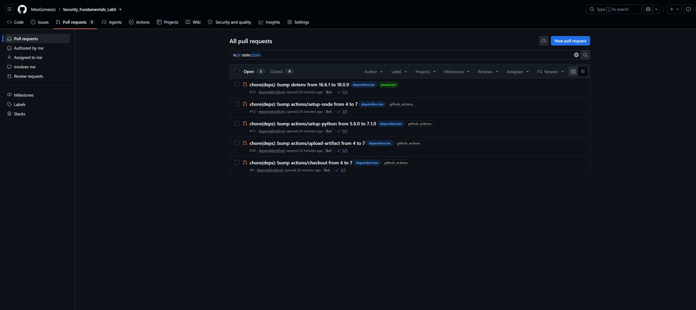

## Hallazgo F-09 — Frontend sin cabeceras de seguridad
- **Título:** El servidor del frontend no envía CSP, anti-clickjacking, `X-Content-Type-Options` ni otras cabeceras de seguridad.
- **Categoría OWASP/CWE:** A05:2021 Security Misconfiguration / CWE-693 (protección insuficiente) y CWE-1021 (restricción inadecuada de frames). Alertas ZAP 10038, 10020, 10021, 10063 y 90004.
- **Severidad y justificación:** Media (ZAP: 2 Medium, CSP y anti-clickjacking, más 4 Low). Sin CSP, un XSS futuro no tendría contención; sin anti-clickjacking, el dashboard puede incrustarse en un frame ajeno. Hoy no hay XSS demostrado y la app no maneja sesiones, lo que modera el impacto.
- **Evidencia minimizada:** [`zap-report.json`](../evidence/ZAP/zap-report-before/zap-report.json) (6 nov 2026): CSP (3 instancias), Anti-clickjacking (3), `nosniff` (5), Permissions-Policy (4), COEP/COOP/CORP (3 cada una).
- **Impacto:** Integridad del cliente (clickjacking) y confidencialidad (efectos de un posible XSS).
- **Pasos de validación segura:** `curl -i http://127.0.0.1:3000/` y revisar las cabeceras; o repetir el workflow DAST pasivo.
- **Corrección (8 nov 2026, commit `f775052`):** opción (a), `helmet` en `web-frontend/server.js` con una CSP propia sin `unsafe-inline` (`default-src 'self'`, `script-src 'self'`, `style-src 'self'`, `frame-ancestors 'none'`, entre otras), `X-Frame-Options: DENY`, COEP `require-corp`, COOP y CORP `same-origin`, `Referrer-Policy: no-referrer` y `Permissions-Policy`. HSTS queda desactivado mientras el despliegue sea HTTP (Lab 4). Detalle y verificación en `SECURITY.md` 2.8. Opción (b), `add_header` en Nginx, sigue siendo una capa adicional posible. Aunque las tres cabeceras Cross-Origin eran opcionales, se añadieron porque `helmet` las incluye sin coste y ZAP las reportaba.
- **Resultado del reescaneo:** pruebas locales 6/6, `curl` con todas las cabeceras presentes y **ZAP 2.17.0 posterior (8 nov, 23:21 GMT): desaparecen las alertas 10038, 10020, 10021, 10063 y las tres de 90004**; el total pasa de 2 Medium y 6 Low a 0 y 0 (quedan 2 informativas, sin acción). Informe en [`evidence/ZAP/zap-report-after/`](../evidence/ZAP/zap-report-after/).

---

## Registro del pentest controlado

- **Autorización:** María Belén Quintero, viernes 6 de noviembre de 2026. Solo el API local propio, con datos ficticios.
- **Objetivo:** verificar que las rutas de modificación exigen una clave de API válida (control añadido en `70dd82a`).
- **Herramientas:** `curl.exe` en PowerShell y un archivo `body.json` con `{"status":"closed"}`.
- **Clave de API:** definida en `.env` (no versionado); en la captura se muestra tachada. No se reproduce aquí.

| ID | Solicitud | Esperado | Observado | Hora (GMT, cabecera `Date`) | Resultado |
|---|---|---|---|---|---|
| P-01 | `GET http://127.0.0.1:3001/health` | 200 con BD operativa | `200` `{"status":"ok","service":"alerts-api","database":"ok"}` | — | Pasa |
| P-02 | `PATCH /api/alerts/alert-004/status` sin `x-api-key` | 401 | `401 Unauthorized` `{"error":"unauthorized"}` (24 bytes) | Sáb 07 Nov 2026 01:12:57 | Pasa |
| P-03 | Igual con `x-api-key: incorrecta` | 401 | `401 Unauthorized`, mismo cuerpo | 01:13:14 | Pasa |
| P-04 | Igual con la clave real | 200 y cambio de estado | `200 OK`, `alert-004` → `"status":"closed"`, `updated_timestamp` `2026-11-07T01:13:31.373Z` | 01:13:31 | Pasa |

**Observaciones**
- El 401 sin clave y con clave incorrecta es idéntico en código, cuerpo y longitud: no hay un oráculo que distinga "falta" de "incorrecta".
- La respuesta no incluye `X-Powered-By`; solo aparece `Vary: Origin` por CORS.
- P-04 modificó un dato ficticio y generó una fila en `audit_log`; la prueba no es estrictamente "no destructiva" en el sentido de solo lectura, pero es reversible (`PATCH` con `"new"`).
- Las 3 pruebas del API coinciden con las pruebas de regresión de `security.test.js` (ejecutadas el 2026-11-07 00:34:22 UTC: 4/4 en verde).
- Vinculación con los logs: `app/alerts-api/logs/app.log` registra las solicitudes de las pruebas automatizadas (`PATCH … 401`, `GET /api/audit … 401`).

**Conclusión del pentest:** hipótesis **validada**. Recomendación: prueba de regresión positiva (clave válida → 200), rotación de la clave, y registro de intentos fallidos con alerta (ver F-07 sobre la identificación por IP).

**Evidencia:**
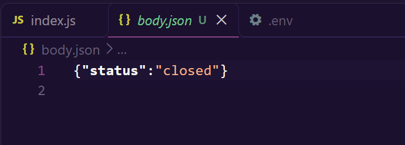

### Prueba equivalente antes de la corrección

| ID | Solicitud (sobre el código anterior a `70dd82a`) | Observado | Hora (GMT, cabecera `Date`) |
|---|---|---|---|
| A-01 | `GET /health` | `200` `{"status":"ok","service":"alerts-api","database":"ok"}` | n/a |
| A-02 | `PATCH /api/alerts/alert-004/status`, `{"status":"closed"}`, **sin** `x-api-key` | **`200 OK`**, `alert-004` → `"status":"closed"`, `updated_timestamp` `2026-11-08T22:55:03.786Z`; la respuesta incluye `X-Powered-By: Express` | Dom 08 Nov 2026 22:55:03 |
| A-03 | Igual, con `x-api-key: incorrecta` | **`200 OK`**, mismo efecto, `updated_timestamp` `2026-11-08T22:56:09.246Z` | 22:56:09 |

La misma solicitud que después devuelve `401` (P-02 y P-03) era aceptada: el control de acceso de F-03 no existía, y `X-Powered-By` (F-06) estaba presente. Las pruebas "antes" se hicieron el 8 nov 2026 (17:55 hora local) en una copia local del repositorio.

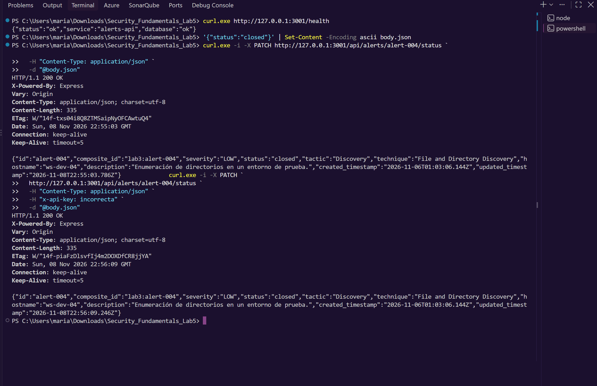

---

## Reflexión final
**Qué identificaron las herramientas.** CodeQL encontró el único problema de lógica de aplicación que consistía en rutas sin rate limiting. Dependabot detectó el riesgo más grave (`proxy-addr` crítico) en dependencias que nosotras nunca declaramos directamente. Semgrep encontró riesgos de cadena de suministro del CI y configuración de Nginx. Gitleaks no encontró secretos, lo cual coincide con la estructura que ya tiene del repositorio (`.env` ignorado, plantilla con marcadores).

**Qué omitieron.** Ninguna herramienta detectó que las rutas de escritura no tenían autenticación: esa clase de fallo (control de acceso) requiere entender la intención de la aplicación y se halló por revisión y prueba manual. Tampoco se detectaron la errata del archivo de Dependabot (F-08) ni el posible cupo compartido por IP (F-07), que surgen de leer la arquitectura completa.

**Cómo integrar seguridad en el ciclo de desarrollo.** (1) Mantener los checks en cada PR y volverlos bloqueantes tras el triage (hoy `|| true`). (2) Mantener Dependabot activo (F-08, ya verificado con 5 PR del bot) y fijar acciones por SHA con actualización automática, haciendo triage de los PR que abre, sobre todo los de versión mayor. (3) Convertir cada hallazgo corregido en una prueba de regresión, como ya se hizo con 401 y 429. (4) Hacer revisión de control de acceso en cada endpoint nuevo, porque las herramientas automáticas no la cubren. (5) Guardar siempre el artefacto de cada escaneo en `evidence/`, no solo en Actions, que caduca (el informe ZAP se archivó en `evidence/ZAP/`). (6) Darle a ZAP la lista de rutas de la API (por ejemplo con una definición OpenAPI) para que el DAST llegue a `/api`.
