# Seguridad del proyecto — evidencia del laboratorio 5

> Documento maestro de evidencia. Reúne, por herramienta, lo que se ejecutó, lo que se encontró y dónde está el soporte.
> Los marcadores **⚠️ PENDIENTE** indican capturas o artefactos que no existen todavía en el repositorio; la ruta sugerida ya está escrita para agregarlos sin tocar la estructura.
> Índice completo de entregables: [`evidence/lab5/README.md`](../evidence/lab5/README.md).

## 1. Alcance autorizado
- Repositorio: <https://github.com/MissGomezzz/Security_Fundamentals_Lab5>
- Rama evaluada y commit base de la línea base: `security/lab5-fdsi` / `09d876b4ca5e5c8db6af2053852e88e2487763f4` (2 de noviembre de 2026, "Adding evidence from SAST process").
- Estado tras las remediaciones: `main` @ `9968a09` (merge del PR #7, 8 de noviembre de 2026, 11:54).
- Estado final evaluado: `main` @ `4f31229` (8 de noviembre de 2026, 14:19). Desde `9968a09` hay commits de documentación y evidencia, el renombrado del archivo de Dependabot (`555a33e`, F-08) y la **migración a Express 5** (`7e76984`, ver §2.7), que se hizo directamente en `main` sin Pull Request.
- Responsable / autorización: María Belén Quintero / viernes 6 de noviembre de 2026. Integrantes: María Belén Quintero Aldana y Ángela Sofía Gómez Valencia.
- Aplicación evaluada: MVP académico `muvautomation-secure-challenge` (frontend Express, `alerts-api`, módulo `audit-service`, PostgreSQL), con **datos completamente ficticios**.
- Entorno de pruebas: máquina local Windows del integrante (API en `127.0.0.1:3001`) y runners efímeros de GitHub Actions. El DAST se ejecuta contra la app levantada dentro del runner, no contra la VM ni contra terceros.
- Fuera de alcance: producción, sistemas de terceros, datos reales y pruebas destructivas.

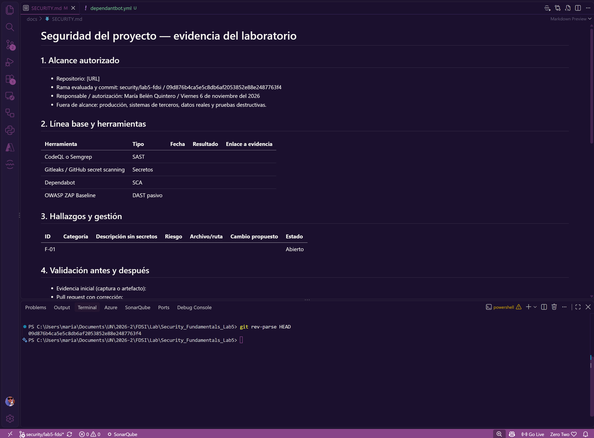

*Captura: `git rev-parse HEAD` en la rama `security/lab5-fdsi` mostrando el commit `09d876b…`, usado para fijar el alcance (la plantilla de este archivo aparece aún sin completar, tal como estaba antes de documentarlo).*

## 2. Línea base y herramientas

| Herramienta | Tipo | Fecha | Resultado | Enlace a evidencia |
|---|---|---|---|---|
| Semgrep 1.182.1 y 1.184.0 (`p/owasp-top-ten`, `p/secrets`) | SAST | 2 nov 2026 (workflow en PR #4/#5; JSON local en `09d876b`) y 8 nov 2026 (reescaneo del árbol de trabajo, commit `7e76984`) | **Tres puntos de medición.** Antes: 9 WARNING. Después del PR #5: 4 (se corrigieron los 5 de acciones sin SHA; quedan 4 de Nginx). Reescaneo del 8 nov: 48 en bruto, **11 accionables** (ver §2.1). 0 errores de escaneo en los tres. | [`semgrep_before.json`](../evidence/SAST/semgrep_before.json), [`semgrep_after_pr5.json`](../evidence/SAST/semgrep_after_pr5.json), [`semgrep_after.json`](../evidence/SAST/semgrep_after.json), [`resumen.py`](../evidence/SAST/resumen.py) |
| CodeQL (Default setup: `javascript-typescript`, `actions`) | SAST | 6 nov 2026 (PR #6) y 8 nov 2026 (`main`) | PR #6: **3 alertas High** (`js/missing-rate-limiting`). `main`: **7 alertas High** detectadas, **0 abiertas / 7 cerradas como "fixed"** tras los PR #6 y #7. | [`hallazgos_CodeQL.png`](../evidence/lab5/hallazgos_CodeQL.png), [`hallazgos_fixed_CodeQL.png`](../evidence/lab5/hallazgos_fixed_CodeQL.png) |
| Gitleaks (`gitleaks-action` fijada por SHA, `fetch-depth: 0`) | Secretos | 28 oct 2026 (workflow) y cada PR | **Sin hallazgos.** Resumen del job: *No leaks detected* (run #18, commit `0bb491d`, 9 s). También en verde en el PR #6. Verificación adicional: `.env` nunca fue versionado (`git log --all -- .env` vacío; está en `.gitignore`). | [`gitleaks_log.png`](../evidence/lab5/gitleaks_log.png), [`all_workflows_pass_before_merge.png`](../evidence/lab5/all_workflows_pass_before_merge.png) |
| Dependabot (alertas de seguridad) y `npm audit` | SCA | 6–8 nov 2026 | **Antes: 5 alertas abiertas** (1 Critical, 1 High, 3 Moderate), todas transitivas. **Después: 0 abiertas / 5 cerradas "Fixed"** y `npm audit`: *found 0 vulnerabilities*. | [`alertas_iniciales_dependatbot.png`](../evidence/lab5/alertas_iniciales_dependatbot.png), [`alertas_fixed_dependatbot.png`](../evidence/lab5/alertas_fixed_dependatbot.png), [`npm_audit_y_outdated.png`](../evidence/lab5/npm_audit_y_outdated.png), [`npm_audit_after.png`](../evidence/lab5/npm_audit_after.png), [`dependabot_prs_abiertos.png`](../evidence/lab5/dependabot_prs_abiertos.png) (5 PR de actualización abiertos por el bot) |
| OWASP ZAP 2.17.0 Baseline (`zap-baseline.py`, modo pasivo) | DAST pasivo | 6 nov 2026, 17:32 UTC (informe inicial) | **0 High, 2 Medium, 6 Low, 2 Informational** (10 tipos de alerta) sobre 5 recursos del frontend (`127.0.0.1:3000`). Todas son de cabeceras HTTP; ninguna alcanzó `/api`. Ver §2.4. | [`zap-report.html`](../evidence/ZAP/zap-report.html), [`zap-report.json`](../evidence/ZAP/zap-report.json), [`zap.yaml`](../evidence/ZAP/zap.yaml) |
| Pruebas de regresión (`node --test`) | Prueba funcional de seguridad | 7 nov 2026 | 7 nov: 4/4 pruebas pasan (sin X-Powered-By, 401 sin clave, 401 con clave incorrecta, 401 en `/api/audit`). 8 nov: **5/5** con la prueba de rate limiting añadida en `38cf99b` (61 solicitudes, las últimas responden 429). | [`security_test.png`](../evidence/lab5/security_test.png), [`security_test_5_pruebas.png`](../evidence/lab5/security_test_5_pruebas.png), [`security.test.js`](../app/alerts-api/test/security.test.js) |

> **Advertencia de lectura.** Los workflows usan `|| true` en Semgrep y `-I` en ZAP para no bloquear el laboratorio. Que el check salga verde **no** significa que la aplicación sea segura; el resultado se interpreta con los hallazgos de este documento.

### 2.1 Semgrep (SAST)
Configuración: [`seguridad-estatica.yml`](../.github/workflows/seguridad-estatica.yml), job `sast`. Reglas comunitarias OWASP Top Ten y secretos; salida `semgrep.json` publicada como artefacto `resultado-semgrep`. El resumen se obtiene con `python evidence/SAST/resumen.py`.

| | Antes ([`semgrep_before.json`](../evidence/SAST/semgrep_before.json)) | Después del PR #5 ([`semgrep_after_pr5.json`](../evidence/SAST/semgrep_after_pr5.json)) | Reescaneo 8 nov ([`semgrep_after.json`](../evidence/SAST/semgrep_after.json)) |
|---|---|---|---|
| Versión de Semgrep / archivos analizados | 1.182.1 / 56 | 1.182.1 / 56 | 1.184.0 / 67 |
| Total | 9 | 4 | 48 (11 accionables) |
| Severidad | 9 WARNING | 4 WARNING | 46 WARNING, 2 MEDIUM |
| `github-actions-mutable-action-tag` | 5 (`seguridad-estatica.yml` líneas 14, 15, 24, 33, 37) | **0** | 5 (`seguridad-estatica.yml` 45 y 46; `dast-local.yml` 32, 33 y 56) |
| `request-host-used` (Nginx) | 4 (`nginx_before.conf` 7 y 13; `muvautomation-hardened.conf` 48; `muvautomation.conf` 14) | 4 | 4 (sin cambio) |
| `dependabot-missing-cooldown` | n/a (el archivo no existía con el nombre correcto) | n/a | 2 (`dependabot.yml` líneas 3 y 7) |
| `plaintext-http-link` | 0 | 0 | 37, **todos en `evidence/ZAP/zap-report.html`** |
| Errores del escaneo | 0 | 0 | 0 |

**Cómo leer el reescaneo del 8 nov.** El JSON `semgrep_after.json` se sobrescribió con un escaneo posterior (commit `7e76984`); por eso la medición "después del PR #5" (4 hallazgos) se conservó como `semgrep_after_pr5.json`, recuperada de `09d876b`. Las 48 coincidencias se clasifican así:

| Grupo | Cantidad | Triage |
|---|---|---|
| Acciones con tag mutable (`@v4`) en el job `pruebas` y en `dast-local.yml` | 5 | **Verdadero positivo.** Es la parte pendiente de F-04, que el análisis del PR #6 ya anticipaba |
| `request-host-used` en Nginx | 4 | F-05, riesgo aceptado. Dos están en `evidence/retest/nginx_before.conf`, una copia de evidencia |
| `dependabot-missing-cooldown` | 2 | **Hallazgo nuevo, de bajo valor.** Aparece porque el archivo ya se llama `dependabot.yml` (F-08) y Semgrep sí lo analiza. Mitigación: añadir `cooldown` (días de espera antes de proponer una versión recién publicada) |
| `plaintext-http-link` en `zap-report.html` | 37 | **Falso positivo.** Son enlaces a la documentación de ZAP dentro de un informe archivado, no código de la aplicación. Se evita excluyendo `evidence/` con un `.semgrepignore` |

Corrección de lo ya resuelto: commit `d043d24` ("fixing workflow with SHA!"), que fija cada acción de terceros a un SHA de commit inmutable con el tag como comentario. Ver F-04 en el [reporte de hallazgos](REPORTE_HALLAZGOS.md).

> Para comparar: `python evidence/SAST/resumen.py evidence/SAST/semgrep_after_pr5.json` (o cualquiera de los otros dos).

> ⚠️ **PENDIENTE (opcional pero recomendable): captura del job *Semgrep (SAST)* en Actions** con el artefacto `resultado-semgrep`. Ruta: `evidence/lab5/semgrep_job_actions.png`. Para agregarla, quitar los comentarios de la línea siguiente.
>
> <!--  -->
>
> Hoy la evidencia de Semgrep son los tres JSON de `evidence/SAST/` y el check "Semgrep (SAST)" en verde visible en [`pr7_ya_fucionado.png`](../evidence/lab5/pr7_ya_fucionado.png) y [`all_workflows_pass_before_merge.png`](../evidence/lab5/all_workflows_pass_before_merge.png).

### 2.2 CodeQL
Default setup de GitHub (no hay un workflow CodeQL propio, para no duplicar el análisis). Lenguajes: `javascript-typescript` y `actions`.

**Detección inicial, PR #6 (commit `40b58fa`, "refactor: file name and middleware")** — 3 alertas *Missing rate limiting* (High) en `app/alerts-api/src/index.js` líneas 139, 157 y 180: "This route handler performs a database access, but is not rate-limited".

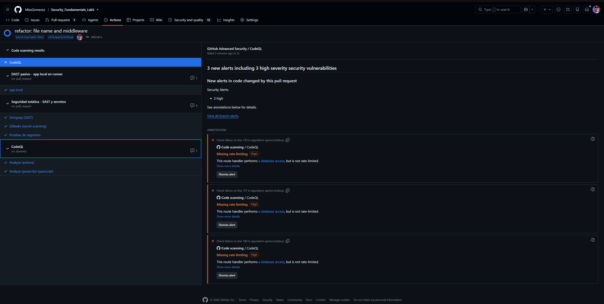

**Estado final en `main`** — 0 abiertas, 7 cerradas como *fixed*: seis en `alerts-api/src/index.js` (líneas 64, 74, 97, 105, 118, 136) y una en `web-frontend/server.js:29`. Esta última aparece cuando CodeQL analiza `main` y se cierra al fusionar el PR #7.

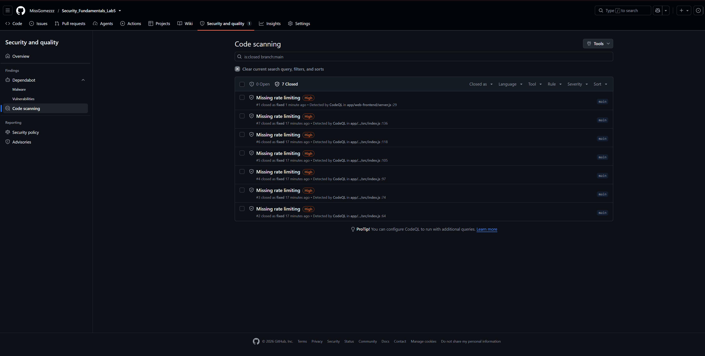

> Las líneas de las alertas de `main` no coinciden con las del PR #6 porque son versiones distintas del archivo. En ambos casos la regla es la misma: rutas que consultan la base de datos sin límite de peticiones.

### 2.3 Gitleaks / Secret Scanning
- Job `secretos` en [`seguridad-estatica.yml`](../.github/workflows/seguridad-estatica.yml): checkout con `fetch-depth: 0` (historial completo) y `gitleaks-action` fijada por SHA.
- Resultado: **pasa sin hallazgos.** El resumen del job indica *No leaks detected* (run #18 de `seguridad-estatica.yml`, disparado por el push `0bb491d` a `main`, duración 9 s). También pasó en el PR #6 y en el PR #7.
- Higiene complementaria: `.env` está en `.gitignore`; `.env.example` solo contiene marcadores (`placeholder_change_for_local_only`); `API_KEY` en los workflows se lee de `secrets.API_KEY` y nunca está escrita en el repositorio; en la captura del pentest la clave real aparece **tachada**.
- Limitación conocida: en repositorios de organización `gitleaks-action` puede exigir `GITLEAKS_LICENSE`. Este repositorio es personal, así que no aplica.

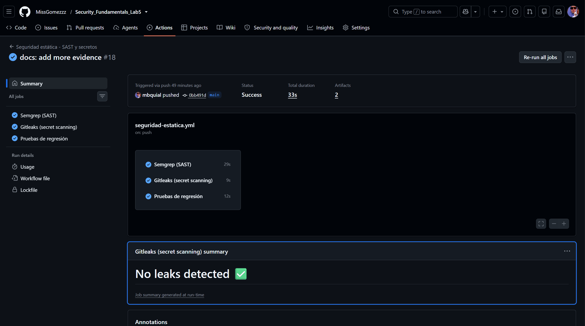

*No se habilitó o no se documentó el Secret Scanning nativo de GitHub; la cobertura de este entregable es Gitleaks, que la guía permite como alternativa.*

### 2.4 OWASP ZAP Baseline
Workflow [`dast-local.yml`](../.github/workflows/dast-local.yml): levanta PostgreSQL 16 como servicio del runner, carga los datos ficticios (`npm run seed`), arranca `alerts-api` y `web-frontend` en el runner y ejecuta `zap-baseline.py -t http://127.0.0.1:3000` sobre `ghcr.io/zaproxy/zaproxy:stable`. Es **estrictamente pasivo** y solo contra la app local del runner. El job `zap-local` pasó en los PR #6 y #7 (ver §2.5).

**Informe archivado:** [`evidence/ZAP/zap-report.html`](../evidence/ZAP/zap-report.html), [`zap-report.json`](../evidence/ZAP/zap-report.json) y el plan de automatización [`zap.yaml`](../evidence/ZAP/zap.yaml) (artefacto `informe-zap`). ZAP 2.17.0, generado el **6 nov 2026 a las 17:32:36 (UTC)**, objetivo `http://127.0.0.1:3000`. Por la hora, es una ejecución **anterior** a la API key y al `x-powered-by` de la API (`70dd82a`, 13:22 hora local), es decir, el informe **inicial**.

| Riesgo | Alertas |
|---|---|
| High | 0 |
| Medium | 2 |
| Low | 6 |
| Informational | 2 |
| Falsos positivos marcados | 0 |

Alcance real del escaneo: ZAP registró 4 endpoints en sus *insights* y las alertas citan 5 URL del frontend: `/`, `/app.js`, `/styles.css`, `/robots.txt` y `/sitemap.xml`. Todas con método GET y código 2xx. **No se alcanzó ninguna ruta `/api/*`**, de modo que ZAP no evaluó la API. El spider fue de 1 minuto como máximo y no se ejecutó escaneo activo (ver `zap.yaml`).

| # | Alerta | Riesgo (confianza) | CWE | Instancias | Triage | Acción |
|---|---|---|---|---|---|---|
| 1 | Content Security Policy (CSP) Header Not Set | Medium (High) | 693 | 3 | **Verdadero positivo.** El frontend no envía CSP | F-09 |
| 2 | Missing Anti-clickjacking Header | Medium (Medium) | 1021 | 3 | **Verdadero positivo.** Sin `X-Frame-Options` ni `frame-ancestors` | F-09 |
| 3 | Cross-Origin-Embedder-Policy Missing | Low (Medium) | 693 | 3 | Verdadero, bajo valor para esta app | F-09 (opcional) |
| 4 | Cross-Origin-Opener-Policy Missing | Low (Medium) | 693 | 3 | Verdadero, bajo valor | F-09 (opcional) |
| 5 | Cross-Origin-Resource-Policy Missing | Low (Medium) | 693 | 3 | Verdadero, bajo valor | F-09 (opcional) |
| 6 | Permissions Policy Header Not Set | Low (Medium) | 693 | 4 | Verdadero, bajo valor | F-09 (opcional) |
| 7 | Server Leaks "X-Powered-By" (`Express`) | Low (Medium) | 497 | 5 | **Verdadero.** Sigue sin deshabilitarse en el frontend (ver F-06) | F-06 |
| 8 | X-Content-Type-Options Header Missing | Low (Medium) | 693 | 5 | **Verdadero positivo** | F-09 |
| 9 | Modern Web Application | Info (Medium) | n/a | 3 | Informativa: el spider estándar no sigue enlaces de una SPA | Sin acción; usar el Client Spider para ampliar cobertura |
| 10 | Storable but Non-Cacheable Content | Info (Medium) | 524 | 5 | Informativa: `Cache-Control: max-age=0` de Express estático | Sin acción |

Observaciones de la revisión:
- `robots.txt` y `sitemap.xml` devuelven el HTML de la aplicación (`<script src="/app.js">`) con 2xx: el comodín de `web-frontend/server.js` (`app.get('*')` cuando se hizo el escaneo; `app.get('/{*splat}')` desde la migración a Express 5) responde `index.html` a cualquier ruta, incluso inexistente. No es una vulnerabilidad por sí sola, pero explica que ZAP los trate como recursos válidos y vuelve poco fiable el código de estado.
- Las cabeceras faltantes son del servidor Express del frontend (puerto 3000). La configuración endurecida de Nginx añade `X-Content-Type-Options`, `X-Frame-Options` y `Referrer-Policy`, pero **no** CSP, Permissions-Policy ni las cabeceras Cross-Origin, y no oculta `X-Powered-By` que viene del upstream. En el runner de CI no hay Nginx, por lo que el DAST ve el frontend sin esas capas.
- No hay reporte "después". Para obtenerlo, tras corregir F-06 y F-09, volver a ejecutar el workflow (*Actions → DAST pasivo → Run workflow*) y guardar el nuevo informe en `evidence/ZAP/after/`.

> ⚠️ **PENDIENTE (opcional): captura del resumen del informe HTML** de ZAP (tabla "Summary of Alerts"). Ruta: `evidence/lab5/zap_resumen.png`.
>
> <!--  -->
>
> ⚠️ **PENDIENTE (depende de corregir F-06 y F-09): informe ZAP "después".** Ejecutar *Actions → DAST pasivo → Run workflow*, descargar el artefacto `informe-zap` y guardarlo en `evidence/ZAP/after/` (`zap-report.html`, `zap-report.json`). Cuando exista, completar la columna "Después" de la tabla de §4.
>
> **Nota sobre el escaneo existente.** Es anterior a la migración a Express 5 (§2.7). Si se vuelve a ejecutar, el resultado reflejará ya Express 5.

### 2.5 Pipeline completo antes del merge
Siete checks verdes en el PR #6: CodeQL (actions), CodeQL (javascript-typescript), Code scanning results / CodeQL ("No new alerts in code changed by this pull request"), Gitleaks, Pruebas de regresión, Semgrep y DAST pasivo (ZAP). El PR #7 ya fusionado muestra 8 checks en verde (se añade CodeQL para `python`, que aparece al incluir `evidence/SAST/resumen.py`).

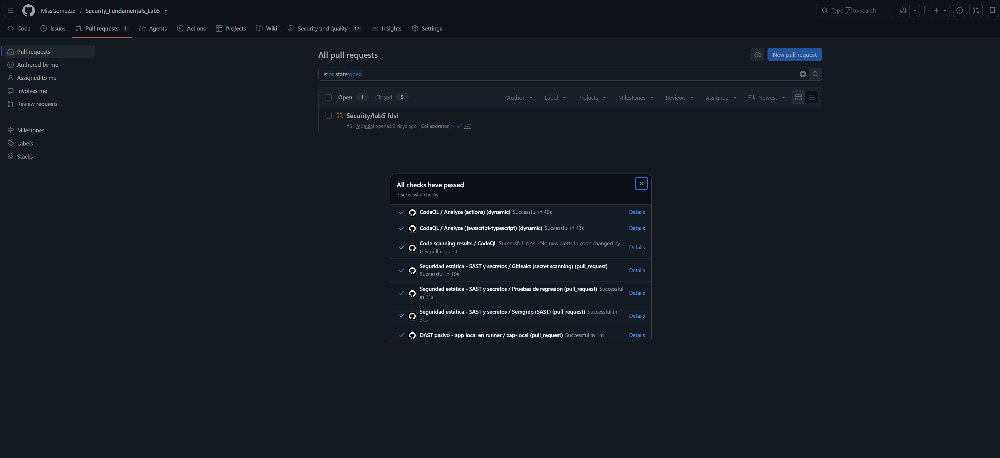

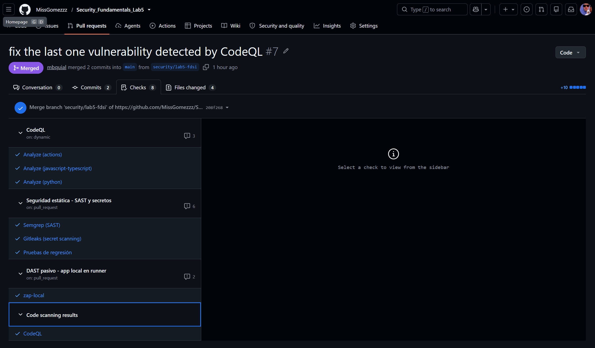

### 2.6 Dependabot (SCA)
Cinco alertas abiertas al inicio, todas en `package-lock.json` y transitivas (dependencias de `express`):

| # | Paquete | Severidad | Advisory | Versión vulnerable → corregida |
|---|---|---|---|---|
| 3 | `proxy-addr` | **Critical** | IP spoofing vía subred de confianza IPv4-mapped IPv6 | 2.0.7 → 2.0.8 |
| 4 | `body-parser` | **High** | DoS por bytes finales tras un cuerpo comprimido | 1.20.8 → 1.20.9 |
| 2 | `qs` | Moderate | Bypass del límite de arrays con comas (`GHSA-x5fp-wj9c-mxmx`) | 6.15.3 → 6.16.2 |
| 1 | `qs` | Moderate | DoS por `isBuffer` controlado por el atacante (`GHSA-4mjr-xmp4-gh2g`) | 6.15.3 → 6.16.2 |
| 5 | `qs` | Moderate | `qs.stringify` con `arrayFormat: 'comma'` lanza TypeError (`GHSA-6pq8-jhm2-2vcw`) | 6.15.3 → 6.16.2 |

También `express` 4.22.2 → 4.22.3. La copia anidada `body-parser/node_modules/qs` 6.16.0 desaparece del lockfile (queda deduplicada en 6.16.2). La corrección es el commit `541cc20` ("chore: update dependencies in package-lock.json"), que solo toca `package-lock.json`.

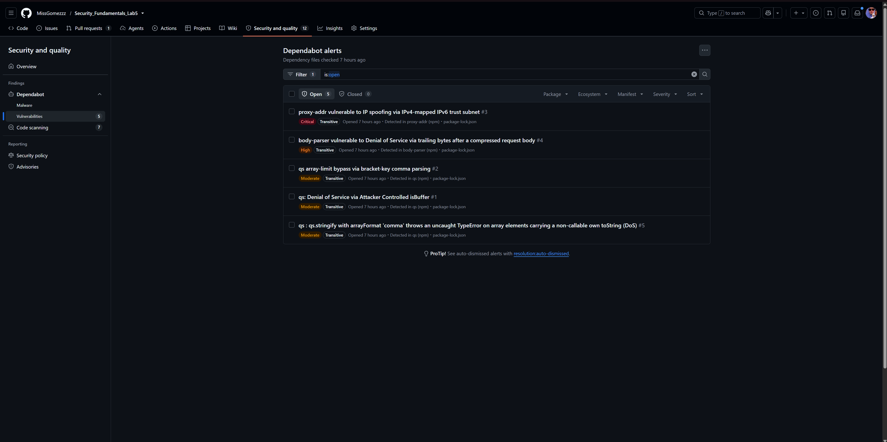

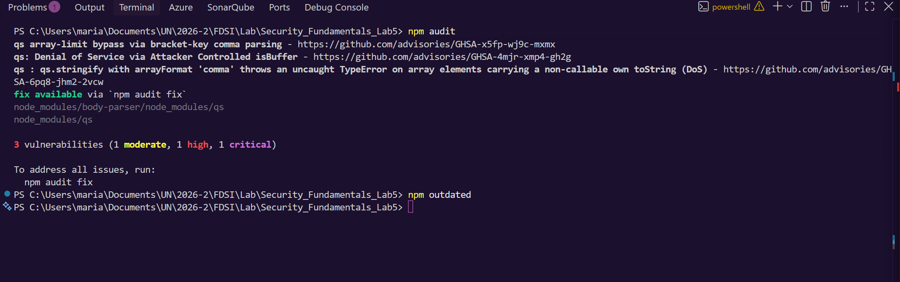

*`npm audit` agrupa por paquete (3 paquetes: `qs`, `body-parser`, `proxy-addr`); Dependabot lista cada advisory (5).*

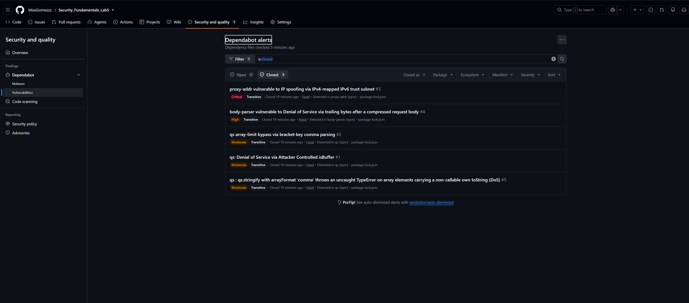

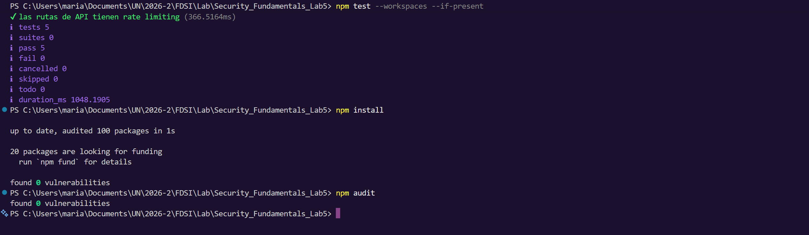

*Tras actualizar el lockfile, `npm install` y `npm audit` informan `found 0 vulnerabilities` (100 paquetes auditados). La misma captura muestra `npm test --workspaces --if-present` con 5/5 pruebas.*

> **Hallazgo de proceso (F-08):** el archivo de configuración se llamaba `.github/dependatbot.yml` (errata). GitHub solo lee `.github/dependabot.yml`, así que **las actualizaciones de versión programadas (semanal, `npm` y `github-actions`) no estaban activas**. Las *alertas* de seguridad sí funcionaban porque no dependen de ese archivo. **Corrección:** el archivo se renombró a `.github/dependabot.yml` (commit `555a33e`, contenido sin cambios).

**Verificación de F-08: Dependabot ya abre PR de actualización.** Tras el renombrado, el bot abrió **5 Pull Requests** (#9 a #13) pocos minutos después, lo que confirma que ahora lee la configuración. Todos tienen la etiqueta `dependencies` y `javascript` o `github_actions` según el ecosistema, y los 5 pasan sus 5 checks:

| PR | Actualización | Ecosistema | Checks |
|---|---|---|---|
| #9 | `actions/checkout` 4 → 7 | github_actions | 5/5 |
| #10 | `actions/upload-artifact` 4 → 7 | github_actions | 5/5 |
| #11 | `actions/setup-python` 5.6.0 → 7.1.0 | github_actions | 5/5 |
| #12 | `actions/setup-node` 4 → 7 | github_actions | 5/5 |
| #13 | `dotenv` 16.6.1 → 18.0.9 | npm | 5/5 |

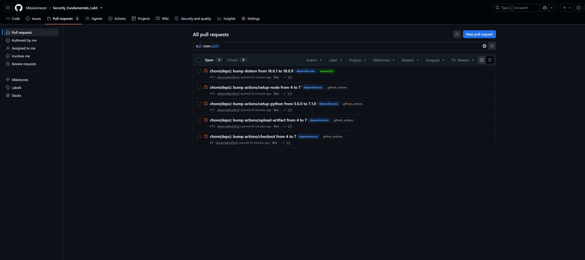

*Captura del listado de PR abiertos del repositorio: 5 abiertos, todos del bot `dependabot[bot]`, con 5/5 checks.*

Lectura de estos PR:
- Los cuatro de `github_actions` actualizan acciones que el repositorio referencia por tag (`@v4`) y por SHA fijado (`checkout`, `setup-python` y `upload-artifact` en `seguridad-estatica.yml`). Dependabot es la vía prevista para mantener al día las acciones fijadas por SHA (F-04) sin volver a tags mutables. Antes de fusionarlos conviene revisar las notas de cada salto de versión mayor (4 → 7).
- El de `npm` (`dotenv` 16 → 18) también es un salto de versión mayor.
- Estas actualizaciones **no son parte de las correcciones del laboratorio**: son una consecuencia de activar F-08 y están pendientes de triage.

### 2.7 Migración a Express 5 (cambio posterior al PR #7)
El commit `7e76984` (8 nov 2026, 14:10, mensaje "docs: add and change documentation") subió `express` de `^4.21.2` a `^5.3.0` en `alerts-api` y `web-frontend`, regeneró `package-lock.json` y cambió en `web-frontend/server.js` el comodín `app.get('*')` por `app.get('/{*splat}')`, porque Express 5 (`path-to-regexp` v8) no admite el comodín sin nombre. **Se hizo directamente en `main`, sin Pull Request y sin revisión de los checks previos al merge.**

Versiones resueltas en el lockfile de `main` @ `4f31229`, comprobadas el 8 nov 2026:

| Paquete | Antes (lockfile del PR #6) | Ahora | Estado frente a los advisories de F-02 |
|---|---|---|---|
| `express` | 4.22.3 | **5.3.0** | n/a |
| `body-parser` | 1.20.9 | 2.4.0 | Fuera del rango vulnerable (≤ 1.20.8) |
| `qs` | 6.16.2 | 6.17.1 | Por encima de la versión corregida (6.16.2) |
| `proxy-addr` | 2.0.8 | 2.0.8 | Versión corregida |

Verificación local (Windows, Node, 8 nov 2026, 22:41 UTC): `npm audit` → *found 0 vulnerabilities*; `npm test --workspaces --if-present` → 5 de 5 pruebas (la última, 61 solicitudes con las primeras en 401 y las siguientes en 429). `npm audit` con Express 5 no se había capturado antes: [`npm_audit_after.png`](../evidence/lab5/npm_audit_after.png) corresponde al lockfile de Express 4.22.3.

Lo que **no** está verificado:
- No hay ejecución de CI sobre `4f31229` en las capturas, solo la verificación local de arriba.
- No se ha repetido el DAST ni una prueba manual de la ruta comodín con Express 5.
- No hay Pull Request que documente el cambio; el informe lo trata como una remediación fuera de PR.

> ⚠️ **PENDIENTE: captura de `npm audit` y `npm test` sobre `main` @ `4f31229` (Express 5)** y del run de `seguridad-estatica.yml` para ese commit. Rutas: `evidence/lab5/express5_audit_tests.png` y `evidence/lab5/express5_ci_run.png`.
>
> <!--  -->
> <!--  -->

## 3. Hallazgos y gestión

| ID | Categoría | Descripción sin secretos | Riesgo | Archivo/ruta | Cambio aplicado | Estado |
|---|---|---|---|---|---|---|
| F-01 | A04 Insecure Design / CWE-770 (CodeQL `js/missing-rate-limiting`) | 7 rutas con acceso a base de datos sin límite de peticiones | Alto | `app/alerts-api/src/index.js`, `app/web-frontend/server.js` | `express-rate-limit` 60 req/min en API (`38cf99b`) y frontend (`7fe9051`) | **Corregido** (PR #6, #7) |
| F-02 | A06 Vulnerable Components / CWE-1395 | 5 advisories en `proxy-addr`, `body-parser`, `qs` | Crítico | `package-lock.json` | Actualización del lockfile (`541cc20`) | **Corregido** (PR #6) |
| F-03 | A01 Broken Access Control / CWE-306 | Endpoints de escritura y auditoría sin autenticación | Alto | `alerts-api/src/index.js` (POST/PATCH/aggregates/audit) | Middleware `requireApiKey` con `timingSafeEqual` (`70dd82a`) | **Corregido** (PR #6) |
| F-04 | A08 Supply Chain / CWE-829 (Semgrep) | 5 acciones de GitHub con tag mutable | Medio | `.github/workflows/seguridad-estatica.yml`, `dast-local.yml` | Fijadas por SHA en Semgrep y Gitleaks (`d043d24`). El reescaneo del 8 nov confirma 5 `@v4` restantes (job `pruebas` y `dast-local.yml`) | **Corregido** parcial: ver F-04 en el reporte |
| F-05 | A05 Misconfiguration (Semgrep `request-host-used`) | `$host` usado en `proxy_set_header Host` | Bajo | `nginx/*.conf` | — | **Abierto / riesgo aceptado** |
| F-06 | A05 / CWE-497 (ZAP 10037) | Cabecera `X-Powered-By: Express` | Bajo | `alerts-api/src/index.js`, `web-frontend/server.js` | `app.disable('x-powered-by')` solo en la API (`70dd82a`) + prueba | **Corregido en la API; abierto en el frontend** |
| F-07 | A04 / CWE-770 | Posible rate limiting global por IP del proxy | Medio | `alerts-api`, `web-frontend` | — | **Abierto** (hipótesis sin validar) |
| F-08 | A06 / proceso | Config de Dependabot con nombre de archivo erróneo | Bajo | `.github/dependabot.yml` | Archivo renombrado (`555a33e`). Dependabot abrió 5 PR (#9 a #13) | **Corregido y verificado** |
| F-09 | A05 / CWE-693 y CWE-1021 (ZAP) | Frontend sin CSP, anti-clickjacking, `nosniff` ni otras cabeceras de seguridad | Medio | `app/web-frontend/server.js`, `nginx/*.conf` | — | **Abierto** |

Detalle técnico completo de cada ID: [`REPORTE_HALLAZGOS.md`](REPORTE_HALLAZGOS.md).

## 4. Validación antes y después

| Control | Antes | Después |
|---|---|---|
| Semgrep | 9 WARNING | 4 WARNING tras el PR #5 (5 corregidos). En el reescaneo del 8 nov: 48 en bruto, 11 accionables (5 de F-04 pendientes, 4 de F-05, 2 nuevos de `cooldown`); 37 son falsos positivos del informe ZAP archivado |
| CodeQL | 3 alertas High en el PR; 7 en `main` | 0 abiertas, 7 cerradas "fixed" |
| Dependabot | 5 abiertas (1 C, 1 H, 3 M) | 0 abiertas, 5 cerradas "Fixed" |
| `npm audit` | 3 vulnerabilidades (1 M, 1 H, 1 C) | 0 vulnerabilidades (con Express 4.22.3 y de nuevo con Express 5.3.0, §2.7) |
| OWASP ZAP | 0 H / 2 M / 6 L / 2 I (informe inicial) | Sin reescaneo; las alertas de cabeceras siguen abiertas (F-09) |
| Escritura sin API key | Aceptada (sin control en el código anterior a `70dd82a`) | 401 Unauthorized |
| Rate limiting | Ausente | 429 al superar 60 req/min (prueba automatizada) |
| Pruebas de regresión | No existían | 5/5 pasan (la 5.ª verifica el 429) |
| Checks del PR | CodeQL falló (3 High) | 7/7 verdes (PR #6) y checks en verde en el PR #7 |

- **Evidencia inicial:** [`hallazgos_CodeQL.png`](../evidence/lab5/hallazgos_CodeQL.png), [`alertas_iniciales_dependatbot.png`](../evidence/lab5/alertas_iniciales_dependatbot.png), [`npm_audit_y_outdated.png`](../evidence/lab5/npm_audit_y_outdated.png), [`semgrep_before.json`](../evidence/SAST/semgrep_before.json).
- **Pull request con corrección:** PR #6 y PR #7. Ver [`PULL_REQUESTS.md`](PULL_REQUESTS.md).
- **Evidencia de reescaneo:** [`npm_audit_after.png`](../evidence/lab5/npm_audit_after.png), [`security_test_5_pruebas.png`](../evidence/lab5/security_test_5_pruebas.png), [`hallazgos_fixed_CodeQL.png`](../evidence/lab5/hallazgos_fixed_CodeQL.png), [`alertas_fixed_dependatbot.png`](../evidence/lab5/alertas_fixed_dependatbot.png), [`semgrep_after.json`](../evidence/SAST/semgrep_after.json), [`all_workflows_pass_before_merge.png`](../evidence/lab5/all_workflows_pass_before_merge.png), [`security_test.png`](../evidence/lab5/security_test.png).
- **Riesgo residual y decisión:** F-05 (se acepta en el laboratorio; mitigación: fijar `server_name` y usar un valor fijo en `Host`), F-06 en el frontend, F-07 y F-09 (se recomienda corregir antes de cualquier uso fuera del laboratorio), y el alcance heredado de Lab 3 (HTTPS pendiente, datos de lectura públicos por diseño, ver [`risk-register.md`](../risk-register.md)). El informe ZAP archivado es el **inicial**: no hay reescaneo que confirme el estado actual de las cabeceras, y el escaneo no cubrió `/api`.

## 5. Pentest autorizado
- **Hipótesis:** las rutas que modifican datos o exponen auditoría (`PATCH /api/alerts/:id/status`) no deben aceptar solicitudes sin una clave de API válida, y una clave incorrecta no debe diferenciarse de la ausencia de clave.
- **Entorno de pruebas aislado:** API local en `http://127.0.0.1:3001`, base PostgreSQL local con datos ficticios, ejecutada por la persona autorizada el 6 de noviembre de 2026 (20:12–20:13 hora local; 01:12–01:13 GMT del 7 de nov. en las cabeceras `Date`).
- **Solicitudes inocuas y respuestas observadas:**

| # | Solicitud | Respuesta | Hora (GMT) |
|---|---|---|---|
| P-01 | `GET /health` | `200` `{"status":"ok","service":"alerts-api","database":"ok"}` | — |
| P-02 | `PATCH /api/alerts/alert-004/status`, cuerpo `{"status":"closed"}`, **sin** `x-api-key` | `401 Unauthorized` `{"error":"unauthorized"}` | 01:12:57 |
| P-03 | Igual, con `x-api-key: incorrecta` | `401 Unauthorized` `{"error":"unauthorized"}` | 01:13:14 |
| P-04 | Igual, con la clave real (tachada en la captura) | `200 OK`, `alert-004` pasa a `status: "closed"` | 01:13:31 |

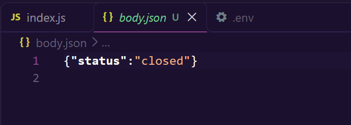

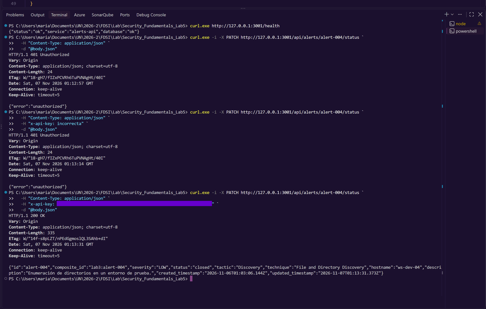

- **Resultado:** **validado.** El control de acceso funciona: sin clave y con clave incorrecta devuelven 401 con mensaje genérico; solo la clave correcta modifica el recurso. Efecto lateral de P-04: `alert-004` (dato ficticio) quedó en `closed` con `updated_timestamp` `2026-11-07T01:13:31Z` y un registro en `audit_log`. Se puede volver a `new` con el mismo endpoint.
- **Límite de la evidencia:** no se capturó la misma prueba **antes** de aplicar `70dd82a`; que la ruta aceptaba escrituras sin clave se deduce del diff del código (`git show 70dd82a`) y de la limitación declarada en el README de Lab 3, no de una captura. Si se desea la prueba "antes", hacer checkout de `09d876b`, repetir P-02 en local y guardar la captura como `evidence/lab5/pentest_before.png`.

> ⚠️ **PENDIENTE: captura del pentest "antes"** (P-02 sobre `09d876b`: se espera `200` en lugar de `401`). Revertir luego el dato (`PATCH` con `"status":"new"`) y tachar la clave si aparece. Ruta: `evidence/lab5/pentest_before.png`.
>
> <!-- 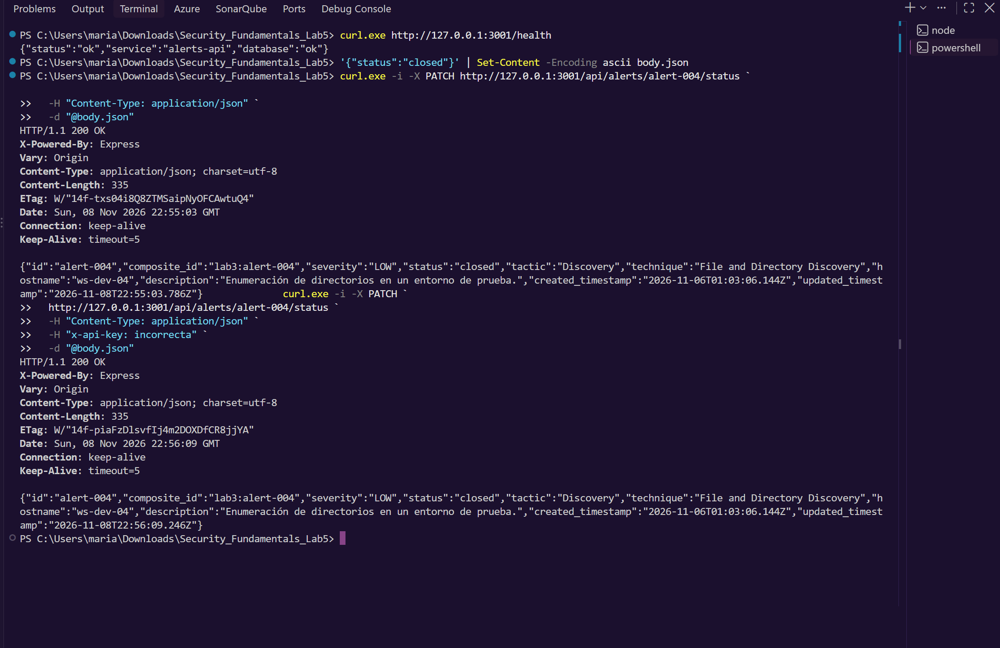 -->
- **Recomendación y prueba de regresión:** mantener las pruebas de [`security.test.js`](../app/alerts-api/test/security.test.js) en CI (job `pruebas`). Ampliar con un caso positivo (clave válida → 200) y rotar `API_KEY` si alguna vez se expone fuera del `.env`.

Registro cronológico detallado: [`REPORTE_HALLAZGOS.md`](REPORTE_HALLAZGOS.md#registro-del-pentest-controlado).
